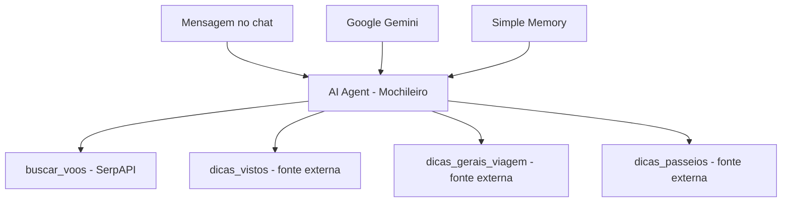

# Mochileiro — Agente de IA para Planejamento de Viagens

Protótipo funcional de um assistente conversacional desenvolvido no **n8n**, integrado ao **Google Gemini**, para responder a perguntas sobre planejamento de viagens e direcionar consultas a ferramentas externas.

> **Status:** protótipo desenvolvido e testado em ambiente de desenvolvimento. **Não publicado em produção.** O arquivo deste repositório é uma versão sanitizada para portfólio: para importá-lo e realizar novas consultas, é necessário configurar suas próprias credenciais.

## Objetivo

Explorar como um agente de IA pode apoiar viajantes em tarefas como levantamento de informações sobre voos, orientações gerais, documentação e sugestões de passeios, combinando um modelo de linguagem com ferramentas externas.

## Tecnologias e conceitos

- **n8n:** construção e orquestração do fluxo;
- **Google Gemini:** modelo de linguagem conectado ao agente;
- **AI Agent (LangChain no n8n):** seleção e acionamento de ferramentas;
- **Simple Memory:** memória de contexto da conversa;
- **HTTP Request Tool:** consultas externas, incluindo configuração de acesso à **SerpAPI / Google Flights**;
- **Prompt engineering:** regras de escopo, escolha de ferramentas, prevenção de respostas inventadas e estruturação das respostas.

## Arquitetura do fluxo

## O que foi implementado

1. Entrada por chat, com o fluxo encaminhado ao nó **AI Agent**.
2. Instruções de sistema em português, restritas ao tema de viagens.
3. Integração com **Gemini** e um componente de **memória conversacional**.
4. Quatro ferramentas HTTP conectadas ao agente para temas específicos.
5. Definição de formatos de resposta e regras para solicitar dados ausentes antes de consultar voos.

## Limitações conhecidas

- **Não há deploy público** nem alegação de operação em produção.
- No fluxo exportado, a consulta de voos contém **parâmetros fixos de origem, destino e datas**; portanto, a busca dinâmica para qualquer rota/data ainda **não foi implementada** nesse arquivo.
- A execução real das integrações depende de credenciais válidas, limites das APIs e da disponibilidade/estrutura das fontes externas.
- As ferramentas HTTP para orientações de viagem usam páginas externas e **não constituem validação automática de requisitos de entrada ou preços**. Informações críticas precisam de confirmação em fontes oficiais.
- Este repositório não inclui métricas de uso, economia de tempo ou usuários reais, pois esses resultados não foram medidos.

## Como visualizar o projeto

1. Abra `mochileiro-workflow.json` para examinar os nós, parâmetros e conexões.
2. Em uma instância do **n8n**, use a opção de importar um workflow de arquivo e selecione esse JSON.
3. Reconfigure **suas próprias credenciais privadas** do Gemini e a autenticação necessária às requisições HTTP. A chave antiga da SerpAPI **não está incluída** no arquivo e deve ser invalidada.
4. Antes de testar, revise os parâmetros de pesquisa de voos, que estão fixos no protótipo, e os endpoints de consulta.

**Segurança:** não coloque chaves de API, tokens, identificadores sensíveis, exemplos com dados pessoais nem arquivos originais de exportação com credenciais neste repositório. Use o gerenciador de credenciais do n8n para autenticação.

## Evoluções possíveis

- Substituir valores fixos de busca de voos por parâmetros fornecidos pelo usuário;
- Melhorar tratamento de erros, indisponibilidade e limites das APIs;
- Adicionar testes, demonstrações visuais e documentação de casos de uso;
- Avaliar publicação de uma interface de demonstração com controle de custos.

## Contexto

Projeto pessoal de estudo e experimentação com **IA generativa, orquestração de agentes, automações e integração de APIs**, documentado para portfólio técnico.
